<!-- Review copy of MCAI510_THA1_Group3_Report_Parts_1_2_Completed.docx. The DOCX controls formatting. -->

# A public services platform serving multiple cities.

Fabio Augusto De Oliveira Dutra

Gumashtha Devangiri Pandukabhaya Punchi Wedikkarage Don

Jose Vidal Asencio Santos

Mehrthur Luís Lemos da Silva

The University of Niagara Falls Canada

Term 1

Teacher : Dr. William Pourmajidi

October 13, 2026

### Introduction

The platform described in the assignment aims to integrate information from public departments across multiple cities to support regional planning, service coordination, and operational decision-making. Its data sources include transportation and environmental sensor readings, geographic locations, citizen service requests, multimedia evidence, maintenance records, emergency response rules, and historical planning information. This diversity requires a database strategy that considers both the characteristics of the data and users’ access requirements.

Figure 1 - Smart City

The main challenge is to support different workloads within a coherent architecture. Managing service requests and work orders requires consistent updates and efficient record retrieval, while sensor monitoring involves frequent data collection and time-based queries.

Geographic searches, image and video storage, and historical analysis introduce additional requirements. The design must therefore evaluate how operational, analytical, and specialized components can work together while accounting for their benefits, costs, and maintenance needs.

This report recommends a database strategy for the Smart Regional Services Platform. It examines platform requirements, database architecture, storage and retrieval approaches, indexing strategies, trade-offs, specialized database models, and contemporary processing paradigms. The final recommendation integrates these choices and identifies implementation priorities to support performance, scalability, and maintainability.

## Part 1 – Platform Requirements Analysis

According to Vazquez and Simões (2016), the main purpose of requirements specification is to document customers’ needs accurately and comprehensively and obtain their approval of the proposed product. It also helps the development team understand what customers expect, serving as an important communication tool between customers and developers.

| Component | Application to the Platform |
| --- | --- |
| Overview | Objective: integrate public service data across multiple cities. Main stakeholders: citizens, municipal teams, emergency response operators, and regional managers. |
| System Models | System models illustrate the relationships between the platform, citizens, municipal departments, and sensors through a context diagram. The requirements analysis table complements this model by documenting the eight data sources, their data types, expected access patterns, potential performance concerns, and initial database design implications. The architecture diagram is presented in Part 2 |
| Functional Requirements | Register service requests, attach evidence, receive sensor readings, query locations, track maintenance, evaluate emergency rules, and retrieve historical data. |
| Nonfunctional Requirements | Performance, scalability, availability, security, and data integrity requirements. Numerical targets not provided in the scenario should be identified as assumptions to be validated. |
| Detailed Requirements Specification | For each function, describe the users, data involved, conditions, rules, and expected outcomes. |

The following table identifies the eight data sources, their expected access patterns, possible performance concerns, and initial database design implications.

| Data Source / Platform Requirement | Type of Data | Expected Access Pattern | Possible Performance Concern | Initial Database Design Implication |
| --- | --- | --- | --- | --- |
| ROAD_AND_FACILITY_LOCATIONS | Spatial points, lines and polygons; structured and variable attributes. | Find nearby facilities, roads intersecting a zone, and locations linked to operational records. | Expensive spatial joins and inconsistent identifiers across stores. | Use PostGIS geometries and spatial indexes; retain stable IDs; justify optional MongoDB attributes against JSONB. |
| MULTIMEDIA | Images and short videos, with structured metadata and contextual links. | Upload once; retrieve metadata and authorized files for a request, inspection or capture. | Large file volumes, upload failures and costly repeated downloads. | Store files in S3 and metadata in PostgreSQL; track upload state, checksum and stable media IDs. |
| TRANSPORTATION_SENSORS | Temporal numerical readings and transit events; device configuration. | Ingest every few seconds; retrieve by sensor, road or intersection, and time range. | Sustained writes, growing history, and slow time-range scans. | Use PostgreSQL operational tables; evaluate time partitioning and sensor/time indexes; keep analytical summaries separate. |
| ENVIRONMENTAL_MONITORING | Temporal numerical measurements, observed events and device documents. | Continuous ingestion; retrieve by device, metric and period; examine threshold events and trends. | High ingestion volume, duplicate deliveries and scans across long periods. | Use MongoDB time-series collections for readings; regular collections for devices/events; validate timestamps, units and references. |
| CITIZEN_SERVICE_REQUESTS | Structured requests, descriptions, assignments and temporal status history. | Create reports; find open requests by city, status or department; retrieve one request and its history. | Concurrent status changes, growing queues and inefficient filtered lists. | Use PostgreSQL transactions, constrained status transitions and indexes aligned with city/status/department queries. |
| FACILITY_MAINTENANCE | Structured inspections, work orders, teams, costs and equipment usage. | Assign work; list outstanding orders; retrieve facility history and cost totals. | Concurrent updates, multi-table retrieval and expensive historical aggregation. | Use transactional PostgreSQL tables and local FKs; index facility/time and status; move reporting aggregates to analytics. |
| EMERGENCY_RULES_AND_RESPONSE | Versioned rules, conditions, alerts, actions and escalation history. | Retrieve effective rules; evaluate incoming events; find unacknowledged alerts and their history. | Event bursts, repeated alerts and slow rule or notification processing. | Store rules and alerts in PostgreSQL; evaluate through a service with version tracking, deduplication and delivery retries. |
| HISTORICAL_PLANNING | Archived reports, temporal summaries and analytical dimensions and facts. | Compare cities, facilities and reporting periods; examine seasonal trends and planning indicators. | Large aggregations competing with operational activity; inconsistent or delayed source data. | Use a separate PostgreSQL analytical database with validated incremental loads, shared dimensions and daily summaries. |

### Requirements Analysis

This platform is an advanced database problem because its information has different structures, arrival rates, relationships, and uses. A citizen request requires accountable assignment and consistent status updates, while a sensor stream produces repeated observations that are normally retrieved by device and time. A geographic query depends on spatial relationships rather than an identifier alone. Multimedia retrieval also involves transferring files whose size greatly exceeds their metadata. The design must coordinate these workloads while keeping identifiers, timestamps, and access controls consistent across participating cities.

Transportation and environmental readings are likely to create sustained storage growth because devices report repeatedly. Queries over long periods can scan many observations unless records are organized around their access patterns. Incoming messages may arrive late or be delivered again, so ingestion needs validation and duplicate handling. Multimedia evidence presents a different challenge: file size, upload reliability, and repeated downloads. The proposed separation between object storage and a searchable metadata catalogue addresses these differences. Geographic searches and historical aggregations can also become expensive as coverage and reporting periods expand.

Several sources require specialized database thinking. Road geometries, facility positions, and service-zone boundaries need spatial operations supported by PostGIS. Sensor measurements require temporal organization, appropriate units, and clear treatment of missing observations. Images and videos need an object-storage approach alongside relational metadata. Emergency response depends on versioned conditions and event evaluation; the proposed rule service evaluates those conditions, while PostgreSQL preserves the rules and resulting actions. Flexible environmental documents and optional location attributes may benefit from document storage, although flexibility alone does not justify introducing another database where JSONB would meet the same requirement.

Operational decisions use current, actionable information. Municipal staff need open citizen requests, assigned maintenance work, and reliable status histories. Emergency operators need relevant observations, effective rules, and alerts awaiting acknowledgement. Transportation and environmental monitoring also support immediate assessments of traffic or hazardous conditions. These same records can support analytical decisions after consolidation: managers can compare congestion, seasonal environmental patterns, request resolution, facility expenditure, and infrastructure usage across cities. Consequently, most operational sources serve both purposes, but analytical queries should run against a separate reporting component rather than competing with service delivery.

The requirements table connects each source to the way it will be accessed and the performance risk that follows. Its database implications are initial design decisions, not measured guarantees. The assignment does not provide device counts, event volumes, file sizes, concurrent-user estimates, latency targets, availability targets, or retention periods. These values must be confirmed before capacity and service-level commitments are established. Access permissions must also distinguish citizens, municipal teams, emergency personnel, and regional managers. Shared identifiers and validated references must preserve links between locations, requests, work orders, and evidence. This combination of workload analysis, specialized data handling, and explicit assumptions provides the basis for the architecture recommendation.

## Part 2 – Database Architecture Recommendation

The overall architecture separates operational service delivery from historical analysis. Figure 2 shows the proposed components, user groups, and major data flows.

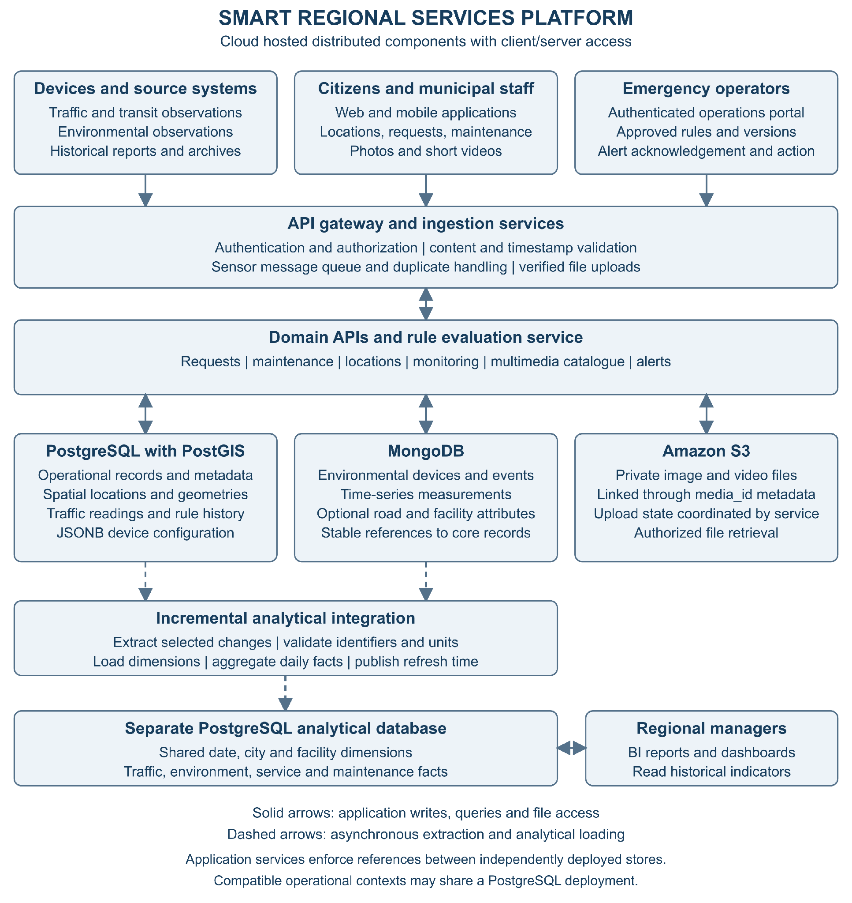

Note. Solid arrows show application access. Dashed arrows show asynchronous analytical integration. Component placement represents responsibilities and does not require one server per context.

### Architecture Justification

We recommend a cloud-hosted distributed architecture with client/server access and polyglot persistence. Applications access domain APIs, and the APIs coordinate several storage components according to their workloads. This follows the storage-selection principle discussed by Fowler (2011): different uses of data can justify different persistence approaches. Distribution here refers to cooperating operational, document, object-storage, and analytical components. It does not require a separate database server for every context, and the design does not assume that every participating city needs an independent database deployment.

Citizens use web or mobile applications to submit requests, attach evidence, and follow progress. Municipal staff use authenticated applications to manage locations, triage requests, and coordinate maintenance. Emergency operators review alerts and record response actions, while regional managers use reporting dashboards. An API gateway provides a common entry point for application traffic. Services check authorization and validate submitted content before accepting changes. Device observations enter through an ingestion service and a message queue so that temporary downstream delays can be absorbed. Upload handling verifies file completion before evidence becomes available to other contexts.

PostgreSQL supports operational transactions for requests, departments, maintenance, transportation devices and readings, multimedia metadata, and emergency rule history. PostGIS extends the location component with geometry storage and spatial queries. JSONB stores transportation device configuration where fields differ by sensor type. Related updates, such as a request status and its history, are committed within the owning operational database. A context identifies ownership and responsibility; several compatible contexts may share one PostgreSQL deployment. Conversely, independently deployed stores exchange stable identifiers through application-managed references rather than relying on cross-database foreign keys.

MongoDB supports environmental device documents, observed events, and a proposed time-series collection for measurements. Supplementary road and facility documents remain optional: their value must be demonstrated against the simpler alternative of keeping variable attributes in PostgreSQL JSONB. Amazon S3 stores images and short videos, while PostgreSQL retains their metadata and evidence links. The upload service coordinates these components through pending, available, and failed states. A rule evaluation service consumes relevant observations, retrieves an approved rule version, and records resulting alerts and actions. Notification delivery uses retries and deduplication; database triggers are not assumed to implement the rule engine.

A separate PostgreSQL analytical database supports historical and planning workloads. An incremental integration process extracts selected operational changes, validates identifiers and units, and loads dimensions before daily facts. Reporting queries compare periods, cities, traffic conditions, environmental measurements, service performance, and maintenance costs. Dashboards display the latest successful refresh time because analytical data may lag behind operational activity. Only metadata and selected indicators need to enter this component; large evidence files remain in S3. Keeping analytical processing separate reduces competition between broad reporting scans and operational transactions.

Scalability comes from expanding ingestion workers and application instances independently, buffering event bursts, and evaluating time partitioning and workload-specific indexes where justified. Additional cities use shared identifiers and city-scoped permissions, while new sources enter through documented ingestion contracts. Maintainability depends on clear context ownership, versioned APIs, schema and document validation, monitored integration jobs, and tested backup and restoration procedures. These choices introduce costs: more components require monitoring, and asynchronous integration creates temporary differences between stores. The implementation should therefore begin with shared locations, operational PostgreSQL services, and the multimedia catalogue, then add specialized components where workload evidence supports them. Capacity, retention, recovery, and response-time targets remain assumptions to validate with stakeholders.

| Schema / Context | Proposed Technology | Responsibility / Business Justification |
| --- | --- | --- |
| ROAD_AND_FACILITY_LOCATIONS | PostgreSQL with PostGIS + MongoDB | PostGIS stores geometries and supports spatial queries; MongoDB stores flexible attributes. Shared identifiers link the records. |
| MULTIMEDIA | PostgreSQL + Amazon S3 | PostgreSQL stores metadata and record links; S3 stores images and videos. |
| TRANSPORTATION_SENSORS | PostgreSQL | Store time-stamped readings, events, and sensor attributes, with JSONB for device configuration. |
| ENVIRONMENTAL_MONITORING | MongoDB | Store time-stamped measurements, events, and device attributes. |
| CITIZEN_SERVICE_REQUESTS | PostgreSQL | Manage requests, statuses, priorities, and responsible departments. |
| FACILITY_MAINTENANCE | PostgreSQL | Manage inspections, work orders, teams, costs, and completion status. |
| EMERGENCY_RULES_AND_RESPONSE | PostgreSQL + Rule Evaluation Service | Store rules, versions, and history; evaluate events and generate alerts. |
| HISTORICAL_PLANNING | Separate PostgreSQL Analytical Database | Consolidate data for reporting and regional planning. |

The order below begins with shared foundations and progresses to the processes that depend on them. Each context has a defined responsibility, workflow, and data ownership. Contexts may share technologies without requiring a separate physical database for each one.

| Order | Context | Responsibility | Workflow | Dependencies |
| --- | --- | --- | --- | --- |
| 1 | ROAD_AND_FACILITY_LOCATIONS | Maintain cities, roads, public buildings, parks, bus stops, and service zones. |  | Foundational context, independent of the other contexts presented. |
| 2 | MULTIMEDIA | Receive and catalogue images, videos, and, as a proposed extension, audio from different channels. |  | A file can exist before being linked to a request, inspection, or capture event. |
| 3 | TRANSPORTATION_SENSORS | Register devices and record speed, road occupancy, congestion, and public transit events. |  | ROAD_AND_FACILITY_LOCATIONS; MULTIMEDIA when images or videos are involved. |
| 4 | ENVIRONMENTAL_MONITORING | Record air quality, temperature, noise, water levels, and environmental events. |  | ROAD_AND_FACILITY_LOCATIONS; MULTIMEDIA when supporting evidence is available. |
| 5 | CITIZEN_SERVICE_REQUESTS | Register reported problems and support service tracking. |  | ROAD_AND_FACILITY_LOCATIONS; MULTIMEDIA for optional attachments. May generate a maintenance demand. |
| 6 | FACILITY_MAINTENANCE | Plan and track inspections, work orders, teams, equipment, and costs. |  | ROAD_AND_FACILITY_LOCATIONS; MULTIMEDIA for evidence; CITIZEN_SERVICE_REQUESTSwhen work originates from a reported issue. |
| 7 | EMERGENCY_RULES_AND_RESPONSE | Define risk conditions and coordinate alerts, priorities, and escalations. |  | ROAD_AND_FACILITY_LOCATIONS and event sources, including TRANSPORTATION_SENSORS, ENVIRONMENTAL_MONITORING, and CITIZEN_SERVICE_REQUESTS. |
| 8 | HISTORICAL_PLANNING | Consolidate information to analyse trends and support regional decisions. |  | Selected data from the other contexts. |

Organization of data

| Context / Schema | Main Proposed Tables or Collections | Proposed Technology |
| --- | --- | --- |
| ROAD_AND_FACILITY_LOCATIONS | Tables: cities, roads, facilities, service_zones. Collections: road_attributes, facility_attributes. | PostgreSQL with PostGIS + MongoDB |
| MULTIMEDIA | media_assets. Linking tables belong to their respective contexts below. | PostgreSQL for metadata + Amazon S3 for files |
| TRANSPORTATION_SENSORS | monitoring_units, sensors, traffic_readings, transit_events, capture_events, capture_media | PostgreSQL, with JSONB for device configuration |
| ENVIRONMENTAL_MONITORING | Collections: monitoring_devices, environmental_readings, environmental_events | MongoDB |
| CITIZEN_SERVICE_REQUESTS | service_requests, request_status_history, departments, request_media | PostgreSQL |
| FACILITY_MAINTENANCE | inspections, work_orders, work_order_status_history, teams, work_order_costs, equipment_usage, inspection_media | PostgreSQL |
| EMERGENCY_RULES_AND_RESPONSE | response_rules, rule_versions, alerts, alert_actions, escalation_history | PostgreSQL + Rule Evaluation Service |
| HISTORICAL_PLANNING | Proposed analytical tables: fact_traffic_summary, fact_environmental_summary, fact_service_performance, fact_maintenance_cost, dim_date, dim_city, dim_facility | Separate PostgreSQL Analytical Database |

Road And Facility Locations

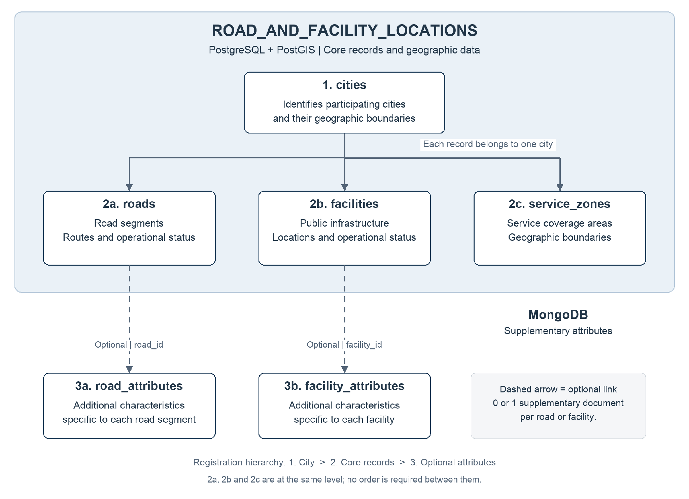

Its responsibility is to maintain the platform’s shared geographic foundation, allowing other contexts to identify cities, roads, public facilities, and service zones.

Arrows represent data associations rather than processing order. PostgreSQL maintains core records and geographic data; MongoDB stores supplementary attributes linked through shared identifiers.

Workflow example: Municipal staff register a park in facilities, linking it to a record in cities. Its geographic location is stored in PostGIS, while supplementary characteristics are stored in facility_attributes using the same identifier. Citizen requests and maintenance records can subsequently reference that park.   Each core record belongs to one city in this proposed model. Roads crossing municipal boundaries are divided into segments. Service zones may overlap because different services can use different coverage boundaries. The application coordinates references and updates between PostgreSQL and MongoDB.

| Table / Collection | Information Stored | Business Justification |
| --- | --- | --- |
| cities | City identifier, name, and geographic boundary. | Organize records by municipality and support comparisons across cities. |
| roads | Road segment identifier, city, name, category, operational status, and geometry. | Locate transportation readings, road-related requests, and interventions. |
| facilities | Facility identifier, city, name, category, operational status, and location. | Provide a common reference for service requests, inspections, and maintenance. Facilities include buildings, parks, parking lots, and bus stops. |
| service_zones | Zone identifier, city, service category, and geographic boundary. | Identify which service areas cover a given location. |
| road_attributes | Supplementary attributes that vary by road category. | Accommodate specific road characteristics without changing the core relational structure. |
| facility_attributes | Supplementary attributes that vary by facility category. | Accommodate details such as building capacity, park equipment, or bus stop amenities. |

Cities

Each record represents a participating city.

| Field | Data Type | Required / Constraint | Purpose |
| --- | --- | --- | --- |
| city_id | UUID | Required; Primary Key | Uniquely identify the city. |
| name | TEXT | Required | Official city name. |
| boundary | GEOMETRY(MultiPolygon, 4326) | Optional | Represent the municipal boundary, when available. |
| created_at | TIMESTAMPTZ | Required | Record when the city was registered. |
| updated_at | TIMESTAMPTZ | Required | Record the latest update time. |

Roads

Each record represents a road segment belonging to one city. Roads crossing municipal boundaries are divided into segments.

| Field | Data Type | Required / Constraint | Purpose |
| --- | --- | --- | --- |
| road_id | UUID | Required; Primary Key | Uniquely identify the road segment. |
| city_id | UUID | cities.city_id | Identify the city responsible for the segment. |
| name | TEXT | Optional | Road name, where available. |
| road_type | TEXT | Required; controlled values | Classify the segment, for example local, arterial, or highway. |
| status | TEXT | Required; controlled values | Indicate its operational state, for example open, restricted, or closed. |
| geometry | GEOMETRY(LineString, 4326) | Required | Represent the geographic path of the segment. |
| created_at | TIMESTAMPTZ | Required | Record registration time. |
| updated_at | TIMESTAMPTZ | Required | Record the latest update time. |

Facilities

Each record represents a public facility or infrastructure asset.

| Field | Data Type | Required / Constraint | Purpose |
| --- | --- | --- | --- |
| facility_id | UUID | Required; Primary Key | Uniquely identify the facility. |
| city_id | UUID | cities.city_id | Identify the city to which the facility belongs. |
| name | TEXT | Required | Facility name or descriptive label. |
| facility_type | TEXT | Required; controlled values | Identify the category: public_building, park, parking_lot, or bus_stop, for example. |
| status | TEXT | Required; controlled values | Indicate whether the facility is operational, restricted, or closed. |
| location | GEOMETRY(Point, 4326) | Required | Store a representative location, such as the main entrance. |
| footprint | GEOMETRY(MultiPolygon, 4326) | Optional | Represent the full geographic area of a building, park, or parking lot. |
| created_at | TIMESTAMPTZ | Required | Record registration time. |
| updated_at | TIMESTAMPTZ | Required | Record the latest update time. |

Service Zones

Each record represents a geographic coverage area for a service within one city.

| Field | Data Type | Required / Constraint | Purpose |
| --- | --- | --- | --- |
| zone_id | UUID | Required; Primary Key | Uniquely identify the zone. |
| city_id | UUID | cities.city_id | Identify the city to which the zone belongs. |
| name | TEXT | Required | Human-readable zone name. |
| service_type | TEXT | Required; controlled values | Identify the service, such as emergency_response, maintenance, or waste_collection. |
| boundary | GEOMETRY(MultiPolygon, 4326) | Required | Define the coverage area. |
| is_active | BOOLEAN | Required | Indicate whether the zone is currently in use. |
| created_at | TIMESTAMPTZ | Required | Record registration time. |
| updated_at | TIMESTAMPTZ | Required | Record the latest update time. |

Road Attributes

Each optional document contains supplementary attributes for one road segment.

| Field | Data Type | Required / Constraint | Purpose |
| --- | --- | --- | --- |
| _id | String containing a UUID | Required; unique | Match the PostgreSQL road_id. |
| attributes | Object | Required | Contain the supplementary road characteristics. |
| attributes.surface_material | String | Optional | Describe the surface, such as asphalt or concrete. |
| attributes.lane_count | Integer | Optional; greater than zero | Record the number of lanes. |
| attributes.cycle_lane_present | Boolean | Optional | Indicate whether a cycle lane is present. |
| attributes.sidewalk_present | Boolean | Optional | Indicate whether a sidewalk is present. |
| created_at | BSON Date | Required | Record document creation time. |
| updated_at | BSON Date | Required | Record the latest update time. |

Facility Attributes

Each optional document contains supplementary attributes for one facility. Fields depend on its category.

| Field | Data Type | Required / Constraint | Purpose |
| --- | --- | --- | --- |
| _id | String containing a UUID | Required; unique | Match the PostgreSQL facility_id. |
| attributes | Object | Required | Contain category-specific facility characteristics. |
| attributes.building_capacity_persons | Integer | Optional; nonnegative | Record the capacity of a public building. |
| attributes.accessible_entrance | Boolean | Optional | Indicate whether an accessible entrance is available. |
| attributes.parking_space_count | Integer | Optional; nonnegative | Record the capacity of a parking facility. |
| attributes.park_amenities | Array of String | Optional | List amenities such as playground, picnic_area, or sports_court. |
| attributes.bus_stop_shelter | Boolean | Optional | Indicate whether a bus stop has a shelter. |
| created_at | BSON Date | Required | Record document creation time. |
| updated_at | BSON Date | Required | Record the latest update time. |

Multimedia

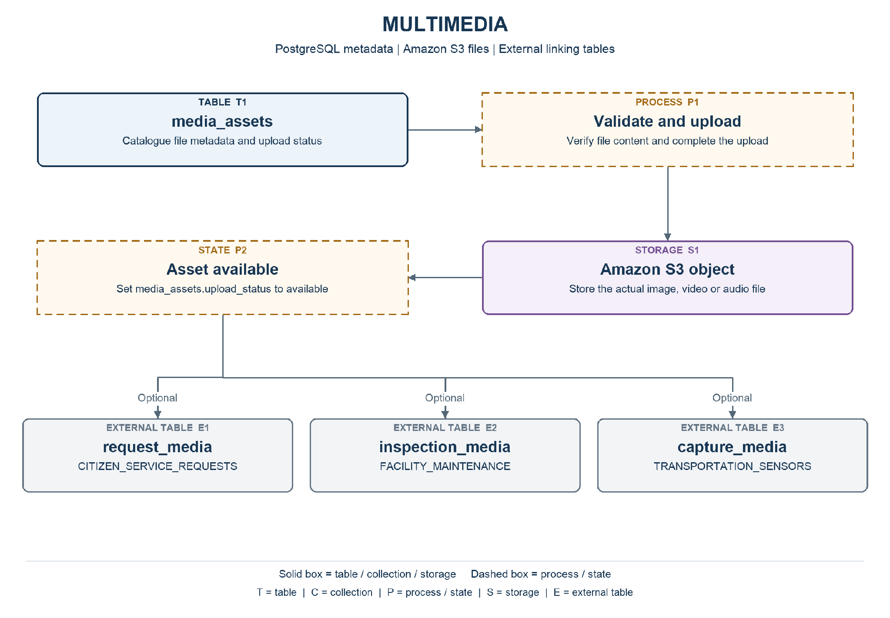

Note. Solid boxes identify tables, collections, or storage. Dashed boxes identify processes or states. External components are labelled. Optional links are marked explicitly.

Responsibility: Receive and catalogue images and videos from citizens, inspectors, and cameras. Audio is an optional extension. The catalogue can exist before an asset is linked to a business record.

Tables and Collections

| Table / Collection | Information Stored | Business Justification |
| --- | --- | --- |
| media_assets | Identify each file, its origin, storage location, and availability status. | Make evidence discoverable and traceable across channels without putting large files in operational tables. |

Fields and Constraints

PK = primary key; FK = foreign key. An external reference is validated by the application or integration service, rather than a foreign key across independent databases. Field definitions below are the proposed logical design.

Media Assets

Identify each file, its origin, storage location, and availability status.

| Field | Data Type | Required / Constraint | Purpose |
| --- | --- | --- | --- |
| media_id | UUID | Required; PK | Uniquely identify the asset. |
| media_type | TEXT | Required; controlled values | image or video; audio only if the extension is enabled. |
| mime_type | TEXT | Required | Validated content type, such as image/jpeg. |
| original_filename | TEXT | Required | Preserve the submitted filename for display. |
| size_bytes | BIGINT | Required; >= 0 | Record the file size in bytes. |
| source_channel | TEXT | Required; controlled values | citizen_portal, field_inspection, or traffic_camera. |
| storage_bucket | TEXT | Required | Name the S3 bucket. |
| storage_key | TEXT | Required; unique with bucket | Identify the object within the bucket. |
| upload_status | TEXT | Required; controlled values | pending, available, or failed. |
| checksum_sha256 | TEXT | Optional | Record a verified checksum for integrity checks. |
| duration_seconds | NUMERIC(12,3) | Optional; >= 0 | Duration of a video or audio asset; absent for images. |
| captured_at | TIMESTAMPTZ | Optional | Capture time supplied by the source, when known. |
| received_at | TIMESTAMPTZ | Required | Time the upload was received. |

Relationships and Validation

The application coordinates S3 and PostgreSQL because a database transaction cannot atomically commit both. Assets remain pending until the upload is verified; failed uploads are retried or cleaned up. Linking tables belong to their originating contexts. Multiple contexts may reference one asset. Files are private and retrieved through authorized application access.

Transportation Sensors

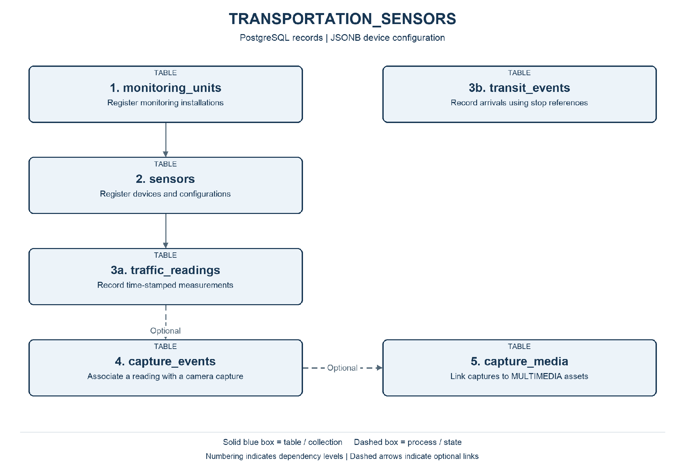

Note. Numbering indicates dependency levels. Solid blue boxes identify tables or collections; dashed boxes identify processes. Dashed arrows indicate optional links.

Responsibility: Maintain monitoring installations and devices, record individual or aggregate traffic measurements, and store transit arrival events. Camera capture is an optional extension to traffic monitoring.

Tables and Collections

| Table / Collection | Information Stored | Business Justification |
| --- | --- | --- |
| monitoring_units | Group devices installed at the same monitoring point. | Keep device installations tied to a shared physical monitoring point. |
| sensors | Register radars, cameras, and other transportation devices. | Support equipment configuration, availability tracking, and maintenance. |
| traffic_readings | Store one measurement from one device at a specified time. | Enable comparisons of traffic conditions by device, place, and time. |
| transit_events | Record actual arrivals and compare them with schedules. | Measure punctuality and identify recurring transit delays. |
| capture_events | Associate an optional camera capture with a traffic reading. | Keep optional camera evidence associated with the relevant measurement for review. |
| capture_media | Associate capture events with multimedia assets. | Retrieve supporting files without duplicating their catalogue records. |

Fields and Constraints

PK = primary key; FK = foreign key. An external reference is validated by the application or integration service, rather than a foreign key across independent databases. Field definitions below are the proposed logical design.

Monitoring Units

Group devices installed at the same monitoring point.

| Field | Data Type | Required / Constraint | Purpose |
| --- | --- | --- | --- |
| unit_id | UUID | Required; PK | Identify the installation. |
| city_id | UUID | Required; external reference | Reference the responsible city. |
| road_id | UUID | Optional; external reference | Reference a road segment. |
| description | TEXT | Required | Describe the monitoring point. |
| lane_number | INTEGER | Optional; > 0 | Identify the monitored lane, when applicable. |
| location | GEOMETRY(Point,4326) | Required | Position of the installation; requires PostGIS. |
| status | TEXT | Required; controlled values | active, inactive, or maintenance. |
| created_at | TIMESTAMPTZ | Required | Record creation time in UTC. |
| updated_at | TIMESTAMPTZ | Required | Latest update time in UTC. |

Sensors

Register radars, cameras, and other transportation devices.

| Field | Data Type | Required / Constraint | Purpose |
| --- | --- | --- | --- |
| sensor_id | UUID | Required; PK | Identify the device. |
| unit_id | UUID | Required; local FK | Reference monitoring_units.unit_id. |
| sensor_type | TEXT | Required; controlled values | radar, camera, occupancy_detector, or other approved type. |
| status | TEXT | Required; controlled values | active, inactive, or maintenance. |
| configuration | JSONB | Required; JSON object | Store device-specific settings validated by sensor type. |
| configuration.sampling_interval_seconds | JSON integer | Radar; > 0 when present | Configure the interval between readings. |
| configuration.measured_variables | JSON array of strings | Radar; optional | List measurements, such as speed_kmh. |
| configuration.capture_mode | JSON string | Camera; optional | triggered or continuous. |
| configuration.resolution | JSON object | Camera; optional | Group output image dimensions. |
| configuration.resolution.width_px | JSON integer | Camera; > 0 when present | Image width in pixels. |
| configuration.resolution.height_px | JSON integer | Camera; > 0 when present | Image height in pixels. |
| created_at | TIMESTAMPTZ | Required | Record creation time in UTC. |
| updated_at | TIMESTAMPTZ | Required | Latest update time in UTC. |

Traffic Readings

Store one measurement from one device at a specified time.

| Field | Data Type | Required / Constraint | Purpose |
| --- | --- | --- | --- |
| reading_id | UUID | Required; PK | Identify the reading. |
| sensor_id | UUID | Required; local FK | Reference the device producing the measurement. |
| source_event_id | TEXT | Required; unique per sensor | Prevent duplicate ingestion of the same source reading. |
| recorded_at | TIMESTAMPTZ | Required | Time of measurement. |
| measurement_type | TEXT | Required; controlled values | speed, occupancy, or congestion_level. |
| numeric_value | DOUBLE PRECISION | Conditional | Value for speed or occupancy; null for categorical readings. |
| category_value | TEXT | Conditional | Congestion category; null for numeric readings. |
| unit | TEXT | Conditional | km/h or percent for numeric readings. |
| lane_number | INTEGER | Optional; > 0 | Lane measured. |
| vehicle_track_id | TEXT | Optional | Temporary equipment tracking identifier for individual vehicles. |

Transit Events

Record actual arrivals and compare them with schedules.

| Field | Data Type | Required / Constraint | Purpose |
| --- | --- | --- | --- |
| transit_event_id | UUID | Required; PK | Identify the event. |
| stop_id | UUID | Required; external reference | Reference a bus stop in facilities. |
| route_id | TEXT | Required | Transit provider route identifier. |
| vehicle_id | TEXT | Required | Transit provider vehicle identifier. |
| source_event_id | TEXT | Required; unique with provider | Identify the source event for duplicate prevention. |
| provider_id | TEXT | Required | Identify the transit data provider. |
| scheduled_at | TIMESTAMPTZ | Optional | Expected arrival time, if supplied. |
| occurred_at | TIMESTAMPTZ | Required | Actual event time. |

Capture Events

Associate an optional camera capture with a traffic reading.

| Field | Data Type | Required / Constraint | Purpose |
| --- | --- | --- | --- |
| capture_id | UUID | Required; PK | Identify the capture. |
| reading_id | UUID | Required; local FK | Reference the associated traffic reading. |
| camera_id | UUID | Required; local FK | Reference a sensor classified as a camera. |
| captured_at | TIMESTAMPTZ | Required | Image capture time. |
| vehicle_track_id | TEXT | Optional | Correlate the captured vehicle with the reading. |
| plate_text | TEXT | Optional | Automatically recognized plate text, if this extension is enabled. |
| plate_confidence | NUMERIC(5,4) | Optional; between 0 and 1 | Confidence of the plate recognition result. |
| review_status | TEXT | Required; controlled values | pending, accepted, or rejected. |

Capture Media

Associate capture events with multimedia assets.

| Field | Data Type | Required / Constraint | Purpose |
| --- | --- | --- | --- |
| capture_id | UUID | Required; composite PK; local FK | Reference the owning record. |
| media_id | UUID | Required; composite PK; external reference | Identify an asset in MULTIMEDIA.media_assets. |
| evidence_role | TEXT | Required | Describe the evidence role, such as before, after, or supporting. |

Relationships and Validation

A sensor belongs to one monitoring unit. A unit references a city and optionally a road segment in the location context. JSONB configuration differs by device type. For radar it may contain sampling_interval_seconds (integer) and measured_variables (array of strings); for cameras, capture_mode (string) and resolution (object with integer width_px and height_px). Individual speed and aggregate occupancy are distinct measurement types. Camera-to-vehicle correlation requires validated timing, lane, and tracking information; an automatic plate result is not a confirmed violation. Local FKs enforce relationships only within this PostgreSQL context.

Environmental Monitoring

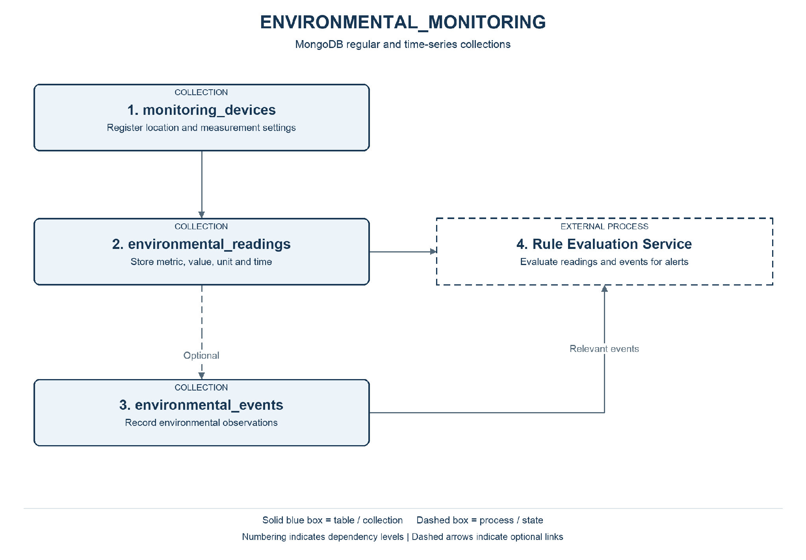

Note. Numbering indicates dependency levels. Solid blue boxes identify tables or collections; dashed boxes identify processes. Dashed arrows indicate optional links.

Responsibility: Maintain device configurations and record environmental measurements and observed events, supporting monitoring and emergency rule evaluation.

Tables and Collections

| Table / Collection | Information Stored | Business Justification |
| --- | --- | --- |
| monitoring_devices | Register devices and their measurement capabilities. | Manage heterogeneous environmental devices and their capabilities. |
| environmental_readings | Store one environmental metric measured at one time. | Support trends and risk detection using traceable measurements. |
| environmental_events | Record environmental observations and source events. | Give operators contextual observations for investigation and response. |

Fields and Constraints

PK = primary key; FK = foreign key. An external reference is validated by the application or integration service, rather than a foreign key across independent databases. Field definitions below are the proposed logical design.

Monitoring Devices

Register devices and their measurement capabilities.

| Field | Data Type | Required / Constraint | Purpose |
| --- | --- | --- | --- |
| _id | String | Required; unique | Application-assigned device identifier. |
| city_id | String (UUID) | Required; external reference | Reference the city. |
| facility_id | String (UUID) | Optional; external reference | Reference the installation hosting the device. |
| location | Object | Required | GeoJSON point representing device position. |
| location.type | String | Required; value Point | Identify the GeoJSON geometry type. |
| location.coordinates | Array<Double> | Required; two values | Longitude followed by latitude. |
| status | String | Required; controlled values | active, inactive, or maintenance. |
| configuration | Object | Required | Device settings. |
| configuration.sampling_interval_seconds | Integer | Required; > 0 | Expected measurement interval. |
| configuration.metrics | Array<Object> | Required | Supported measurements, each with metric (string) and unit (string). |
| updated_at | BSON Date | Required | Latest device update time. |

Environmental Readings

Store one environmental metric measured at one time.

| Field | Data Type | Required / Constraint | Purpose |
| --- | --- | --- | --- |
| reading_id | String | Required; application identifier | Identify the reading for traceability. |
| recorded_at | BSON Date | Required; time field | Time the measurement was taken. |
| metadata | Object | Required; metadata field | Identify the measurement series. |
| metadata.device_id | String | Required; logical reference | Reference monitoring_devices._id. |
| metadata.city_id | String (UUID) | Required; external reference | Identify the responsible city. |
| metadata.metric | String | Required; controlled values | temperature, water_level, noise_level, or a specific air pollutant. |
| metadata.unit | String | Required | Unit appropriate to the metric, such as degC or dB. |
| value | Double | Required | Measured numeric value. |
| quality_status | String | Required; controlled values | valid, suspect, or invalid. |
| received_at | BSON Date | Required | Time the platform received the reading. |

Environmental Events

Record environmental observations and source events.

| Field | Data Type | Required / Constraint | Purpose |
| --- | --- | --- | --- |
| _id | String | Required; unique | Identify the event. |
| device_id | String | Optional; logical reference | Reference the reporting device when applicable. |
| reading_id | String | Optional; logical reference | Reference a supporting measurement. |
| city_id | String (UUID) | Required; external reference | Identify the affected city. |
| event_type | String | Required | Classify the event, such as weather_event or elevated_water_level. |
| occurred_at | BSON Date | Required | Time of the observed event. |
| details | Object | Required | Store event-specific attributes; validate by event type. |

Relationships and Validation

Monitoring_devices and environmental_events are regular collections. environmental_readings is a proposed time-series collection using recorded_at as its time field and metadata as its metadata field. The application generates reading_id for traceability; ingestion duplicate handling is an application responsibility. UUIDs from PostgreSQL are represented consistently as strings. Environmental events represent observations; response alerts are owned by EMERGENCY_RULES_AND_RESPONSE. Missing measurements are not interpreted as zero.

Citizen Service Requests

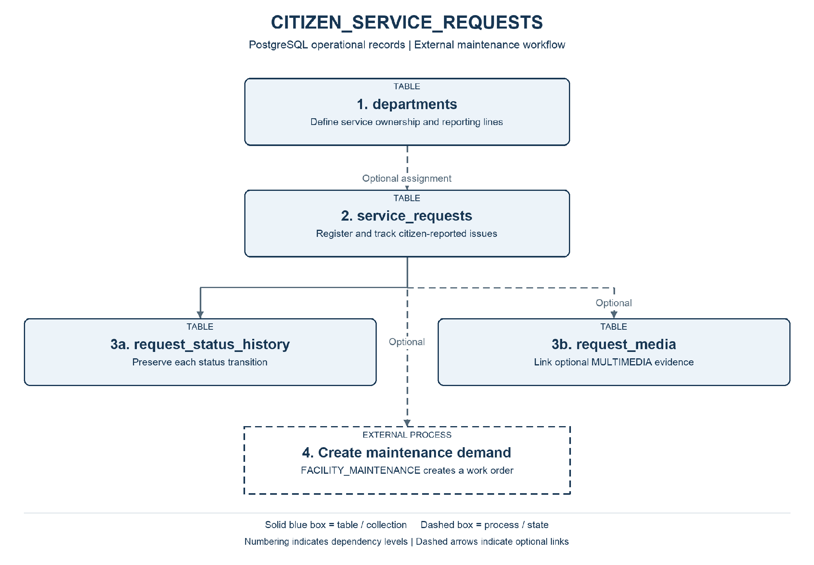

Note. Solid boxes identify tables, collections, or storage. Dashed boxes identify processes or states. External components are labelled. Optional links are marked explicitly.

Responsibility: Register citizen-reported issues, assign departmental ownership, preserve status changes, and link optional supporting evidence.

Tables and Collections

| Table / Collection | Information Stored | Business Justification |
| --- | --- | --- |
| departments | Identify departments responsible for service delivery. | Establish clear ownership and support departmental reporting structures. |
| service_requests | Store each citizen-reported issue and its current state. | Provide reliable citizen issue tracking and accountable assignment. |
| request_status_history | Preserve the progression of a request. | Explain progress, delays, and resolution through an auditable history. |
| request_media | Link requests to optional supporting files. | Make citizen evidence available to the team handling the request. |

Fields and Constraints

PK = primary key; FK = foreign key. An external reference is validated by the application or integration service, rather than a foreign key across independent databases. Field definitions below are the proposed logical design.

Departments

Identify departments responsible for service delivery.

| Field | Data Type | Required / Constraint | Purpose |
| --- | --- | --- | --- |
| department_id | UUID | Required; PK | Identify the department. |
| city_id | UUID | Required; external reference | Reference the responsible city. |
| parent_department_id | UUID | Optional; self FK | Represent a parent department where a hierarchy exists. |
| name | TEXT | Required | Department name. |
| is_active | BOOLEAN | Required | Whether the department accepts assignments. |

Service Requests

Store each citizen-reported issue and its current state.

| Field | Data Type | Required / Constraint | Purpose |
| --- | --- | --- | --- |
| request_id | UUID | Required; PK | Identify the request. |
| tracking_number | TEXT | Required; unique | Provide a public tracking reference. |
| submitted_by_ref | TEXT | Optional | Opaque identity reference; anonymous reports may omit it. |
| city_id | UUID | Required; external reference | Reference the city. |
| road_id | UUID | Optional; external reference | Reference an affected road segment. |
| facility_id | UUID | Optional; external reference | Reference an affected facility. |
| department_id | UUID | Optional; local FK | Reference the assigned department after triage. |
| category | TEXT | Required; controlled values | Classify the issue, such as pothole or broken_streetlight. |
| description | TEXT | Required | Describe the reported problem. |
| location | GEOMETRY(Point,4326) | Required | Position of the issue; requires PostGIS. |
| priority | TEXT | Required; controlled values | low, normal, high, or urgent. |
| status | TEXT | Required; controlled values | submitted, triaged, assigned, in_progress, resolved, or closed. |
| resolved_at | TIMESTAMPTZ | Optional | Time resolution was recorded. |
| created_at | TIMESTAMPTZ | Required | Record creation time in UTC. |
| updated_at | TIMESTAMPTZ | Required | Latest update time in UTC. |

Request Status History

Preserve the progression of a request.

| Field | Data Type | Required / Constraint | Purpose |
| --- | --- | --- | --- |
| history_id | UUID | Required; PK | Identify the transition. |
| request_id | UUID | Required; local FK | Reference service_requests.request_id. |
| from_status | TEXT | Optional | Previous status; absent for initial registration. |
| to_status | TEXT | Required | New status. |
| changed_by_ref | TEXT | Required | Identity or service performing the transition. |
| changed_at | TIMESTAMPTZ | Required | Time of the transition. |
| note | TEXT | Optional | Explain the action or resolution. |

Request Media

Link requests to optional supporting files.

| Field | Data Type | Required / Constraint | Purpose |
| --- | --- | --- | --- |
| request_id | UUID | Required; composite PK; local FK | Reference the owning record. |
| media_id | UUID | Required; composite PK; external reference | Identify an asset in MULTIMEDIA.media_assets. |
| evidence_role | TEXT | Required | Describe the evidence role, such as before, after, or supporting. |

Relationships and Validation

City, road, and facility identifiers reference the location context. A request may identify a precise location without referring to an existing facility. Submitter references are opaque identifiers managed by an identity service; personal contact information is outside this dictionary. Current status and its history are updated in one local transaction. A request can lead to several work orders, each referencing the originating request. Status transitions and priority values are validated by application rules.

Facility Maintenance

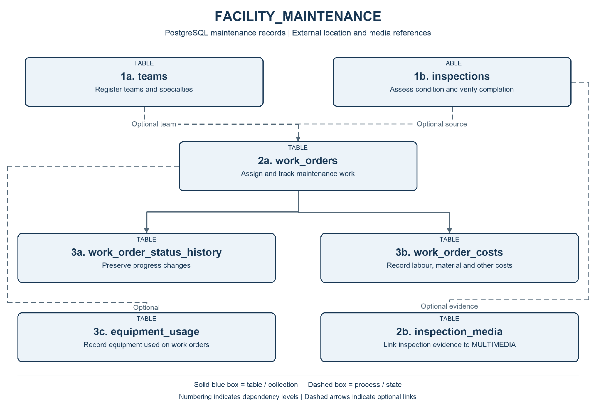

Note. Numbering indicates dependency levels. Solid blue boxes identify tables or collections; dashed boxes identify processes. Dashed arrows indicate optional links.

Responsibility: Coordinate inspections and preventive or corrective maintenance, tracking team assignments, work progress, costs, equipment, and inspection evidence.

Tables and Collections

| Table / Collection | Information Stored | Business Justification |
| --- | --- | --- |
| teams | Identify maintenance teams and their specialties. | Support assignment of work to an appropriate maintenance specialty. |
| inspections | Record an inspection of a public facility. | Document facility condition and support verification of completed repairs. |
| work_orders | Plan and track maintenance execution. | Coordinate execution, priority, scheduling, and completion of maintenance. |
| work_order_status_history | Preserve work order status transitions. | Preserve the progression and responsibility for maintenance actions. |
| work_order_costs | Record individual cost items for a work order. | Support expenditure oversight and comparable cost reporting. |
| equipment_usage | Record equipment used during maintenance. | Provide accountability for equipment deployed during maintenance. |
| inspection_media | Link inspection findings to multimedia evidence. | Support assessment and verification with photographic or video evidence. |

Fields and Constraints

PK = primary key; FK = foreign key. An external reference is validated by the application or integration service, rather than a foreign key across independent databases. Field definitions below are the proposed logical design.

Teams

Identify maintenance teams and their specialties.

| Field | Data Type | Required / Constraint | Purpose |
| --- | --- | --- | --- |
| team_id | UUID | Required; PK | Identify the team. |
| department_id | UUID | Required; external reference | Reference the responsible department. |
| name | TEXT | Required | Team name. |
| specialty | TEXT | Required | Primary maintenance specialty. |
| is_active | BOOLEAN | Required | Whether the team is available for assignment. |

Inspections

Record an inspection of a public facility.

| Field | Data Type | Required / Constraint | Purpose |
| --- | --- | --- | --- |
| inspection_id | UUID | Required; PK | Identify the inspection. |
| facility_id | UUID | Required; external reference | Reference the inspected facility. |
| inspector_ref | TEXT | Required | Identity reference of the inspector. |
| inspected_at | TIMESTAMPTZ | Required | Time of inspection. |
| inspection_type | TEXT | Required; controlled values | routine, issue_assessment, or completion_verification. |
| outcome | TEXT | Required; controlled values | satisfactory, action_required, or follow_up. |
| findings | TEXT | Required | Describe observations and required action. |

Work Orders

Plan and track maintenance execution.

| Field | Data Type | Required / Constraint | Purpose |
| --- | --- | --- | --- |
| work_order_id | UUID | Required; PK | Identify the work order. |
| facility_id | UUID | Required; external reference | Reference the maintained facility. |
| source_request_id | UUID | Optional; external reference | Reference an originating citizen request. |
| source_inspection_id | UUID | Optional; local FK | Reference an inspection that identified the issue. |
| completion_inspection_id | UUID | Optional; local FK | Reference a completion verification inspection. |
| team_id | UUID | Optional; local FK | Reference the assigned team. |
| description | TEXT | Required | Describe the work to perform. |
| maintenance_type | TEXT | Required; controlled values | preventive or corrective. |
| priority | TEXT | Required; controlled values | low, normal, high, or urgent. |
| status | TEXT | Required; controlled values | open, assigned, in_progress, awaiting_verification, completed, or cancelled. |
| scheduled_for | TIMESTAMPTZ | Optional | Planned start time. |
| completed_at | TIMESTAMPTZ | Optional | Verified completion time. |
| created_at | TIMESTAMPTZ | Required | Record creation time in UTC. |
| updated_at | TIMESTAMPTZ | Required | Latest update time in UTC. |

Work Order Status History

Preserve work order status transitions.

| Field | Data Type | Required / Constraint | Purpose |
| --- | --- | --- | --- |
| history_id | UUID | Required; PK | Identify the transition. |
| work_order_id | UUID | Required; local FK | Reference the work order. |
| from_status | TEXT | Optional | Previous status. |
| to_status | TEXT | Required | New status. |
| changed_by_ref | TEXT | Required | Identity or service performing the change. |
| changed_at | TIMESTAMPTZ | Required | Transition time. |
| note | TEXT | Optional | Explain the action. |

Work Order Costs

Record individual cost items for a work order.

| Field | Data Type | Required / Constraint | Purpose |
| --- | --- | --- | --- |
| cost_id | UUID | Required; PK | Identify the cost item. |
| work_order_id | UUID | Required; local FK | Reference the work order. |
| cost_category | TEXT | Required; controlled values | labour, materials, equipment, or external_service. |
| description | TEXT | Required | Describe the cost item. |
| amount | NUMERIC(14,2) | Required; >= 0 | Actual cost amount. |
| currency_code | CHAR(3) | Required | Currency of the cost, such as CAD. |
| recorded_at | TIMESTAMPTZ | Required | Cost recording time. |

Equipment Usage

Record equipment used during maintenance.

| Field | Data Type | Required / Constraint | Purpose |
| --- | --- | --- | --- |
| usage_id | UUID | Required; PK | Identify the usage record. |
| work_order_id | UUID | Required; local FK | Reference the work order. |
| equipment_ref | TEXT | Required | Reference equipment in the municipal asset register. |
| started_at | TIMESTAMPTZ | Required | Start of equipment use. |
| ended_at | TIMESTAMPTZ | Optional; >= started_at | End of use, when known. |
| note | TEXT | Optional | Describe how the equipment was used. |

Inspection Media

Link inspection findings to multimedia evidence.

| Field | Data Type | Required / Constraint | Purpose |
| --- | --- | --- | --- |
| inspection_id | UUID | Required; composite PK; local FK | Reference the owning record. |
| media_id | UUID | Required; composite PK; external reference | Identify an asset in MULTIMEDIA.media_assets. |
| evidence_role | TEXT | Required | Describe the evidence role, such as before, after, or supporting. |

Relationships and Validation

Facility references are owned by ROAD_AND_FACILITY_LOCATIONS and department references by CITIZEN_SERVICE_REQUESTS. inspections may create work orders; work orders may instead originate from a request or preventive activity. No source inspection or request is mandatory for preventive work. inspection_media links before or after inspection evidence. Completion is verified by an inspection linked through completion_inspection_id. Teams and work orders are locally related. Monetary values are stored with a currency code and are not aggregated across currencies without an explicit conversion policy.

Emergency Rules and Response

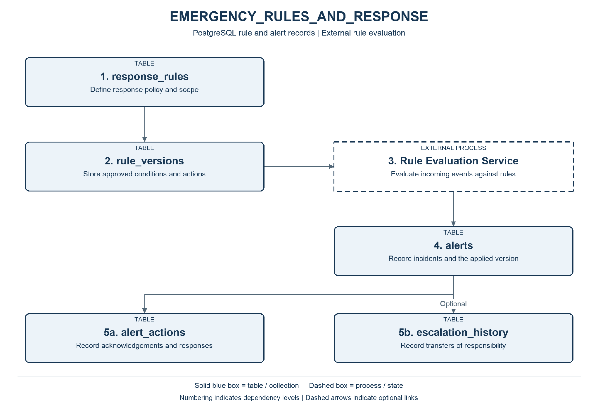

Note. Numbering indicates dependency levels. Solid blue boxes identify tables or collections; dashed boxes identify processes. Dashed arrows indicate optional links.

Responsibility: Maintain approved response rules, evaluate incoming events, and preserve alerts, response actions, and escalation history.

Tables and Collections

| Table / Collection | Information Stored | Business Justification |
| --- | --- | --- |
| response_rules | Identify response policies and their scope. | Provide governed, clearly scoped response policies. |
| rule_versions | Preserve approved conditions and response settings. | Make decisions reproducible using the approved conditions applied at the time. |
| alerts | Record each condition requiring a response. | Keep incidents requiring action visible and prevent duplicate response records. |
| alert_actions | Track acknowledgements and response activities. | Record acknowledgement and follow-through by responsible personnel. |
| escalation_history | Track transfers to additional response authorities. | Show why and when responsibility was escalated. |

Fields and Constraints

PK = primary key; FK = foreign key. An external reference is validated by the application or integration service, rather than a foreign key across independent databases. Field definitions below are the proposed logical design.

Response Rules

Identify response policies and their scope.

| Field | Data Type | Required / Constraint | Purpose |
| --- | --- | --- | --- |
| rule_id | UUID | Required; PK | Identify the policy. |
| name | TEXT | Required | Rule name. |
| description | TEXT | Required | Business purpose of the rule. |
| source_context | TEXT | Required; controlled values | Context whose events the rule evaluates. |
| city_id | UUID | Optional; external reference | Limit the rule to a city; absent for regional scope. |
| zone_id | UUID | Optional; external reference | Limit the rule to a service zone. |
| is_active | BOOLEAN | Required | Whether the policy is enabled. |
| created_at | TIMESTAMPTZ | Required | Record creation time in UTC. |
| updated_at | TIMESTAMPTZ | Required | Latest update time in UTC. |

Rule Versions

Preserve approved conditions and response settings.

| Field | Data Type | Required / Constraint | Purpose |
| --- | --- | --- | --- |
| rule_version_id | UUID | Required; PK | Identify the version. |
| rule_id | UUID | Required; local FK | Reference response_rules.rule_id. |
| version_number | INTEGER | Required; unique per rule | Sequence of versions. |
| conditions | JSONB | Required; validated object | metric (string), operator (string), threshold (number), unit (string), and optional window_seconds (integer). |
| priority | TEXT | Required; controlled values | Priority assigned when the condition is met. |
| target_department_ref | TEXT | Required | Identify the initial responding department. |
| escalation_after_seconds | INTEGER | Optional; > 0 | Delay before escalation if unresolved. |
| approval_status | TEXT | Required; controlled values | draft, approved, or retired. |
| approved_by_ref | TEXT | Conditional | Approver identity; required for approved versions. |
| effective_from | TIMESTAMPTZ | Required | Start of version applicability. |
| effective_to | TIMESTAMPTZ | Optional; > effective_from | End of version applicability. |

Alerts

Record each condition requiring a response.

| Field | Data Type | Required / Constraint | Purpose |
| --- | --- | --- | --- |
| alert_id | UUID | Required; PK | Identify the alert. |
| rule_version_id | UUID | Required; local FK | Reference the exact rule version evaluated. |
| source_context | TEXT | Required | Identify the originating context. |
| source_event_id | TEXT | Required | Identifier of the event or reading evaluated. |
| deduplication_key | TEXT | Required; unique | Prevent duplicate alerts for the same evaluation. |
| priority | TEXT | Required | Priority captured at alert creation. |
| status | TEXT | Required; controlled values | open, acknowledged, in_progress, or closed. |
| triggered_at | TIMESTAMPTZ | Required | Time the alert was generated. |
| closed_at | TIMESTAMPTZ | Optional | Time response was closed. |

Alert_actions

Track acknowledgements and response activities.

| Field | Data Type | Required / Constraint | Purpose |
| --- | --- | --- | --- |
| action_id | UUID | Required; PK | Identify the action. |
| alert_id | UUID | Required; local FK | Reference alerts.alert_id. |
| action_type | TEXT | Required | acknowledged, team_dispatched, status_changed, or closed. |
| performed_by_ref | TEXT | Required | Identity or service performing the action. |
| performed_at | TIMESTAMPTZ | Required | Time of action. |
| note | TEXT | Optional | Describe the action or outcome. |

Escalation History

Track transfers to additional response authorities.

| Field | Data Type | Required / Constraint | Purpose |
| --- | --- | --- | --- |
| escalation_id | UUID | Required; PK | Identify the escalation. |
| alert_id | UUID | Required; local FK | Reference the alert. |
| from_department_ref | TEXT | Required | Previous responsible department. |
| to_department_ref | TEXT | Required | Department receiving the escalation. |
| reason | TEXT | Required | Explain why escalation occurred. |
| escalated_at | TIMESTAMPTZ | Required | Time of escalation. |

Relationships and Validation

The response_rules identifies a policy; rule_versions stores immutable versions. conditions is a JSONB object validated against an approved rule language, not executable SQL supplied by users. The external service performs evaluation; this design does not claim that PostgreSQL triggers execute the rule engine. Each alert records the exact version applied and the source context plus event identifier. Recording an alert and its initial action should be coordinated locally; notification delivery uses retry and deduplication. Only approved, effective versions can be evaluated.

Historical Planning

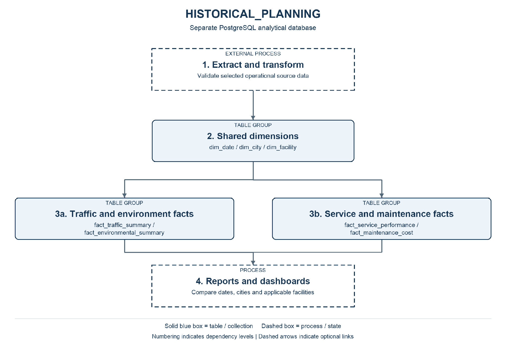

Note. Numbering indicates dependency levels. Solid blue boxes identify tables or collections; dashed boxes identify processes. Dashed arrows indicate optional links.

Responsibility: Consolidate operational information into daily indicators for regional planning without placing reporting workloads on operational stores.

Tables and Collections

| Table / Collection | Information Stored | Business Justification |
| --- | --- | --- |
| dim_date | Provide a shared reporting calendar. | Make reporting periods consistent across operational domains. |
| dim_city | Provide a common city dimension. | Enable consistent comparisons between participating cities. |
| dim_facility | Provide facility context for maintenance indicators. | Connect facility characteristics to maintenance expenditure. |
| fact_traffic_summary | Grain: one city, road segment, and reporting date. | Support road-level trend comparisons for transportation planning. |
| fact_environmental_summary | Grain: one city, metric, unit, and reporting date. | Support environmental comparisons using explicit metrics and units. |
| fact_service_performance | Grain: one city, request category, and reporting date. | Assess service demand and resolution performance by city and category. |
| fact_maintenance_cost | Grain: one facility, currency, and cost-recording date. | Support maintenance budgets and facility investment decisions. |

Fields and Constraints

PK = primary key; FK = foreign key. An external reference is validated by the application or integration service, rather than a foreign key across independent databases. Field definitions below are the proposed logical design.

Dim Date

Provide a shared reporting calendar.

| Field | Data Type | Required / Constraint | Purpose |
| --- | --- | --- | --- |
| date_key | INTEGER | Required; PK | Calendar key in YYYYMMDD form. |
| calendar_date | DATE | Required; unique | Actual reporting date. |
| year_number | SMALLINT | Required | Calendar year. |
| month_number | SMALLINT | Required; 1 to 12 | Calendar month. |
| day_of_week | SMALLINT | Required; 1 to 7 | ISO weekday number. |

Dim City

Provide a common city dimension.

| Field | Data Type | Required / Constraint | Purpose |
| --- | --- | --- | --- |
| city_key | BIGINT | Required; surrogate PK | Identify the analytical city record. |
| source_city_id | UUID | Required; unique | Original city identifier. |
| city_name | TEXT | Required | City name used for reporting. |

Dim Facility

Provide facility context for maintenance indicators.

| Field | Data Type | Required / Constraint | Purpose |
| --- | --- | --- | --- |
| facility_key | BIGINT | Required; surrogate PK | Identify the analytical facility record. |
| source_facility_id | UUID | Required; unique | Original facility identifier. |
| city_key | BIGINT | Required; local FK | Reference dim_city.city_key. |
| facility_name | TEXT | Required | Facility display name. |
| facility_type | TEXT | Required | Facility category. |

Fact Traffic Summary

Grain: one city, road segment, and reporting date.

| Field | Data Type | Required / Constraint | Purpose |
| --- | --- | --- | --- |
| traffic_summary_id | BIGINT | Required; surrogate PK | Identify the daily summary. |
| date_key | INTEGER | Required; local FK | Reference dim_date.date_key. |
| city_key | BIGINT | Required; local FK | Reference dim_city.city_key. |
| source_road_id | UUID | Required; grain key | Original road segment identifier. |
| speed_sample_count | BIGINT | Required; >= 0 | Number of valid speed samples. |
| average_speed_kmh | DOUBLE PRECISION | Optional | Average of comparable valid speed readings. |
| average_occupancy_percentage | DOUBLE PRECISION | Optional; 0 to 100 | Average valid occupancy over the reporting period. |
| loaded_at | TIMESTAMPTZ | Required | Latest successful load time. |

Fact Environmental Summary

Grain: one city, metric, unit, and reporting date.

| Field | Data Type | Required / Constraint | Purpose |
| --- | --- | --- | --- |
| environmental_summary_id | BIGINT | Required; surrogate PK | Identify the daily summary. |
| date_key | INTEGER | Required; local FK | Reference dim_date.date_key. |
| city_key | BIGINT | Required; local FK | Reference dim_city.city_key. |
| metric | TEXT | Required; grain key | Specific environmental variable. |
| unit | TEXT | Required; grain key | Measurement unit; incompatible units are not combined. |
| sample_count | BIGINT | Required; >= 0 | Number of valid samples. |
| minimum_value | DOUBLE PRECISION | Optional | Minimum valid observed value. |
| maximum_value | DOUBLE PRECISION | Optional | Maximum valid observed value. |
| average_value | DOUBLE PRECISION | Optional | Average of comparable samples; not an area-weighted city estimate. |
| loaded_at | TIMESTAMPTZ | Required | Latest successful load time. |

Fact Service Performance

Grain: one city, request category, and reporting date.

| Field | Data Type | Required / Constraint | Purpose |
| --- | --- | --- | --- |
| service_summary_id | BIGINT | Required; surrogate PK | Identify the daily summary. |
| date_key | INTEGER | Required; local FK | Reference dim_date.date_key. |
| city_key | BIGINT | Required; local FK | Reference dim_city.city_key. |
| request_category | TEXT | Required; grain key | Service request category. |
| submitted_count | BIGINT | Required; >= 0 | Requests submitted on this date. |
| resolved_count | BIGINT | Required; >= 0 | Requests resolved on this date. |
| total_resolution_seconds | NUMERIC(20,0) | Required; >= 0 | Sum of creation-to-resolution durations for requests resolved on this date. |
| loaded_at | TIMESTAMPTZ | Required | Latest successful load time. |

Fact Maintenance Cost

Grain: one facility, currency, and cost-recording date.

| Field | Data Type | Required / Constraint | Purpose |
| --- | --- | --- | --- |
| maintenance_summary_id | BIGINT | Required; surrogate PK | Identify the daily summary. |
| date_key | INTEGER | Required; local FK | Reference dim_date.date_key. |
| facility_key | BIGINT | Required; local FK | Reference dim_facility.facility_key. |
| currency_code | CHAR(3) | Required; grain key | Currency used for the cost total. |
| cost_item_count | BIGINT | Required; >= 0 | Number of cost entries recorded on this date. |
| total_cost | NUMERIC(18,2) | Required; >= 0 | Sum of cost entries in the specified currency. |
| loaded_at | TIMESTAMPTZ | Required | Latest successful load time. |

Relationships and Validation

Daily fact tables use a unique constraint on their declared grain. Integration maps source identifiers to analytical keys and loads dimensions before facts. There are no cross-database foreign keys. Group dates in one documented reporting timezone and display the latest successful refresh time. Preserve missing measurements as unknown. Facts join to their applicable dimensions, not to other fact tables.

Entity Relationships

ROAD_AND_FACILITY_LOCATIONS

PK = primary key   FK = foreign key (solid line)   REF = logical reference (dashed)   ID = document identifier

Arrow: parent to child. Label: parent count : child count. 1 = one; 0..1 = optional one; 0..N = zero or many.

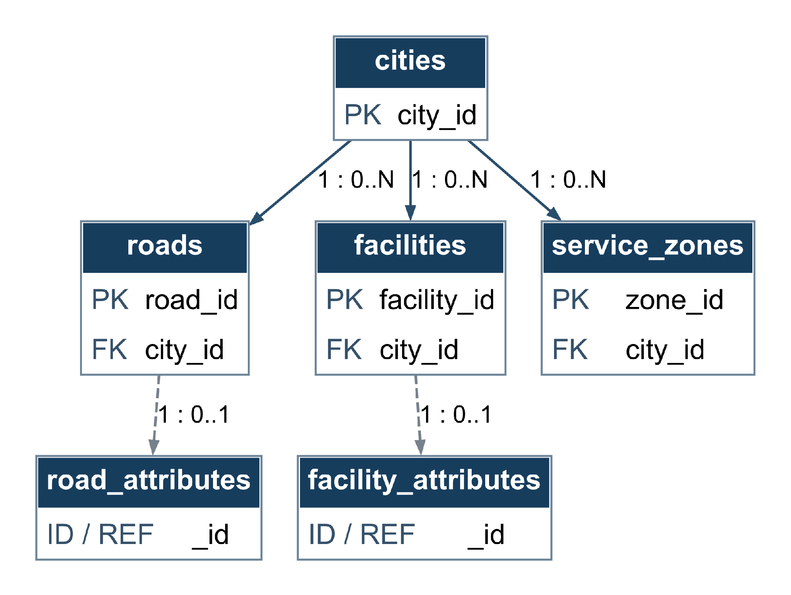

Shared identifiers link each optional MongoDB attribute document to exactly one road or facility. Each parent has at most one such document.

MULTIMEDIA

PK = primary key   FK = foreign key (solid line)   REF = logical reference (dashed)   ID = document identifier

Arrow: parent to child. Label: parent count : child count. 1 = one; 0..1 = optional one; 0..N = zero or many.

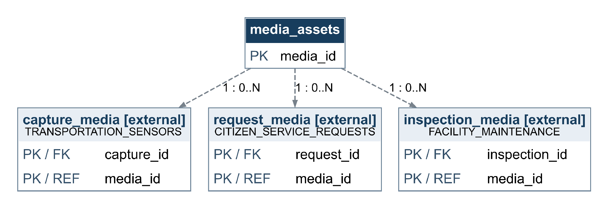

MULTIMEDIA contains only media_assets. capture_media belongs to TRANSPORTATION_SENSORS; request_media belongs to CITIZEN_SERVICE_REQUESTS; inspection_media belongs to FACILITY_MAINTENANCE. These external linking tables reference media_assets. S3 objects are files, not relational tables.

TRANSPORTATION_SENSORS

PK = primary key   FK = foreign key (solid line)   REF = logical reference (dashed)   ID = document identifier Arrow: parent to child. Label: parent count : child count. 1 = one; 0..1 = optional one; 0..N = zero or many.

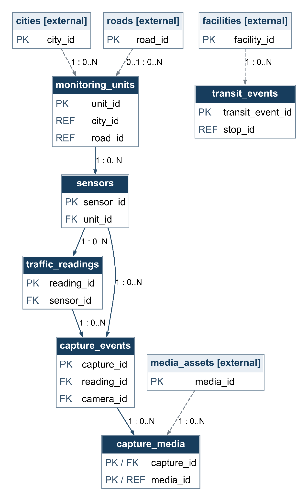

camera_id references a sensor registered as a camera. A reading may have several capture events; reading_id is not unique in capture_events

ENVIRONMENTAL_MONITORING

PK = primary key   FK = foreign key (solid line)   REF = logical reference (dashed)   ID = document identifier

Arrow: parent to child. Label: parent count : child count. 1 = one; 0..1 = optional one; 0..N = zero or many.

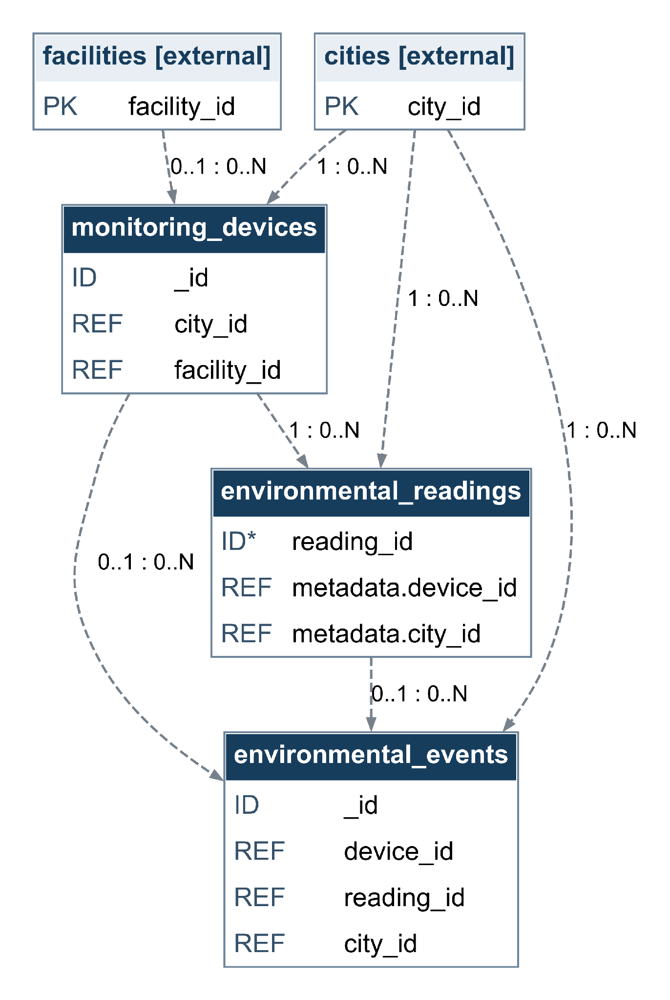

MongoDB collections use logical references, not SQL FKs. ID* reading_id is an application traceability identifier; uniqueness is not enforced by this time-series design.

CITIZEN_SERVICE_REQUESTS

PK = primary key   FK = foreign key (solid line)   REF = logical reference (dashed)   ID = document identifier

Arrow: parent to child. Label: parent count : child count. 1 = one; 0..1 = optional one; 0..N = zero or many.

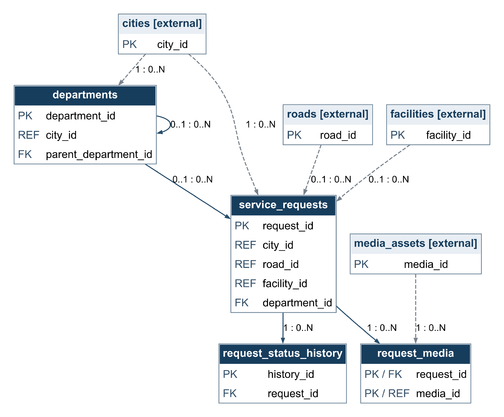

A request may be unassigned and may reference a road or facility. The department hierarchy allows one optional parent and many children; cycles must be prevented.

FACILITY_MAINTENANCE

PK = primary key   FK = foreign key (solid line)   REF = logical reference (dashed)   ID = document identifier

Arrow: parent to child. Label: parent count : child count. 1 = one; 0..1 = optional one; 0..N = zero or many.

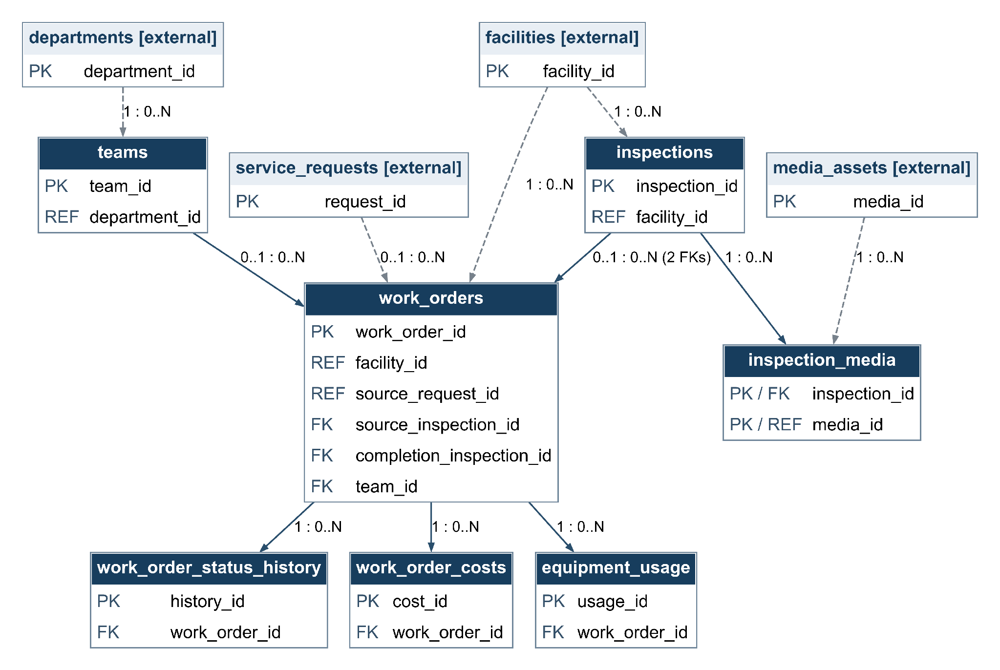

source_inspection_id and completion_inspection_id are separate optional relationships to inspections. Neither field is unique, so neither relationship is one-to-one.

EMERGENCY_RULES_AND_RESPONSE

PK = primary key   FK = foreign key (solid line)   REF = logical reference (dashed)   ID = document identifier

Arrow: parent to child. Label: parent count : child count. 1 = one; 0..1 = optional one; 0..N = zero or many.

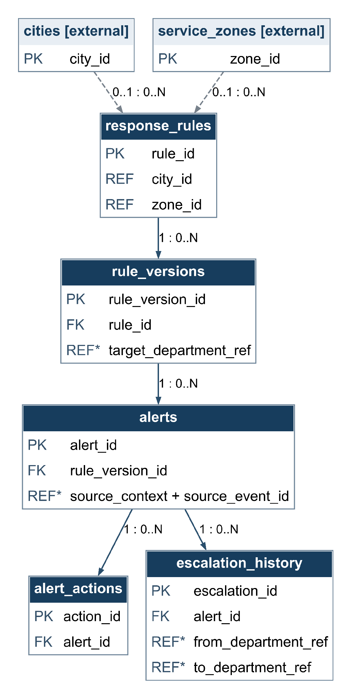

REF* identifies application-managed references. source_context with source_event_id identifies an event in the originating context; it is not a SQL FK. Department references are resolved by the application.

HISTORICAL_PLANNING

PK = primary key   FK = foreign key (solid line)   REF = logical reference (dashed)   ID = document identifier

Arrow: parent to child. Label: parent count : child count. 1 = one; 0..1 = optional one; 0..N = zero or many.

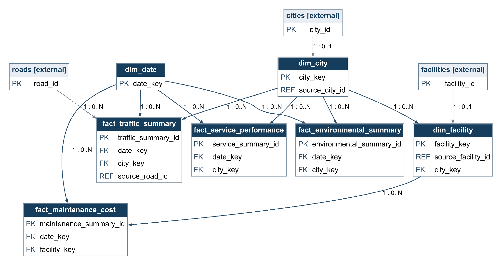

Facts reference shared dimensions. Unique source_city_id and source_facility_id allow at most one current dimension record per source entity. Dashed links show lineage references, not database FKs.

### Conclusion

### References

Análise de Requisitos

The main purpose of requirements specification.
Vazquez, C. E., & Simões, G. S. (2016). Engenharia de requisitos. Brasport.

Poliglot Persistence

Fowler, M. (2011, November 16).

Polyglot persistence. https://martinfowler.com/bliki/PolyglotPersistence.html
